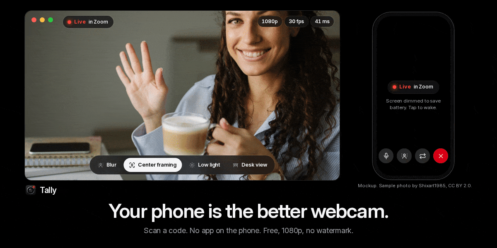
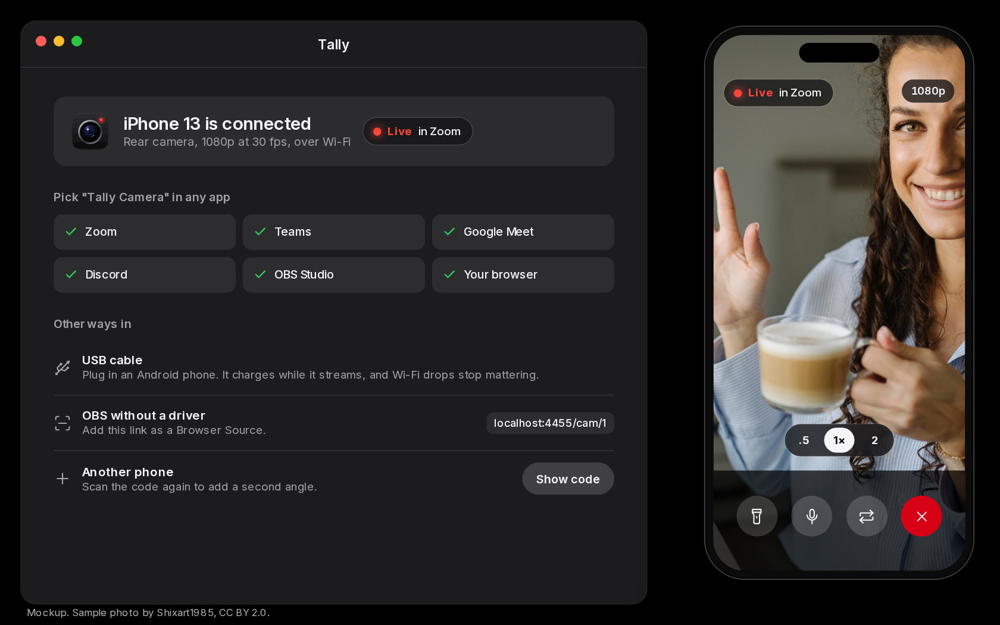
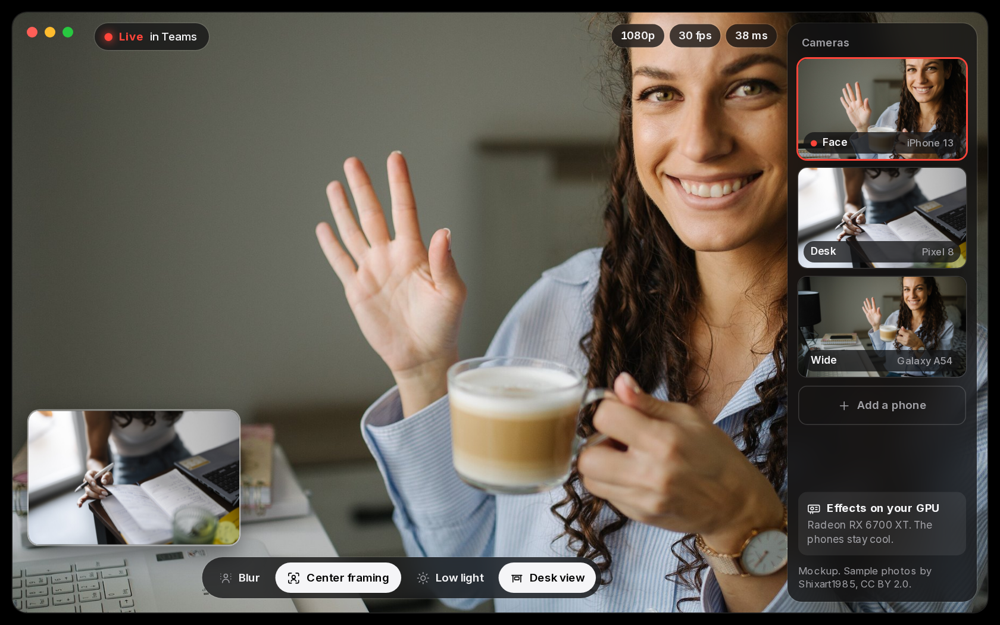
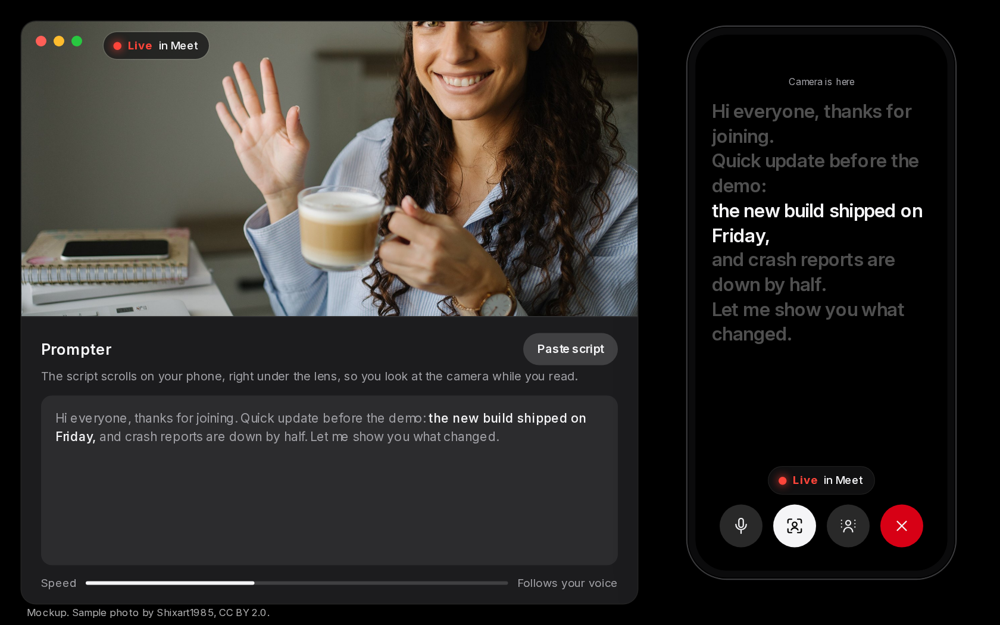

  

  
  
  
  
  

<h1 align="center">Your phone is the better webcam.</h1>

<b>Tally turns any iPhone or Android into a webcam for Windows. Scan a code, and the phone's browser does the rest. No phone app. No watermark. No 480p cap. Free.</b>

  

> [!NOTE]
> **Download:** the Windows build is a single `Tally-setup.exe` — [releases](../../releases/latest). One file, no installer, no account.
>
> The build isn't code-signed yet, so SmartScreen may warn you the first time. Choose **More info**, then **Run anyway**.

## Why Tally

The camera on your phone beats almost any laptop webcam. Using it on Windows usually means an app on the phone, a driver on the PC, and a paywall for HD.

| | The usual phone-webcam apps | Tally |
|---|---|---|
| **On the phone** | An app from the store | **A web page. Scan and go.** |
| **iPhone on Windows** | Often missing or paid | **Works in Safari** |
| **Free tier** | 480p or 720p, ads or a watermark | **1080p, clean** |
| **Effects** | Paid, or only on certain GPUs | **Any GPU: NVIDIA, AMD or Intel** |
| **More than one camera** | Rare | **Up to 4 phones** |

## What you get

### Scan and go

- **No phone app.** The PC shows a QR code, the phone opens a page, and video goes straight to the PC over your Wi-Fi.
- **The good camera.** Use the rear lenses, the torch and zoom from the page.
- **Shows up everywhere** as "Tally Camera": Zoom, Teams, Meet, Discord, OBS, the browser.
- **USB cable** on Android for a steadier picture that charges while it streams.

### A studio of old phones

- **Up to 4 phones** as angles. Switch between them or show one as picture-in-picture.
- **Center framing, blur, low light and desk view** run on your PC's graphics card, any brand, so the phones stay cool.

### The phone becomes your remote

- **Prompter under the lens.** Read your script and still look at the camera.
- **Mute, framing, blur and end** on the phone's screen, which dims while you're live to save battery.

## How it works

1. **Tally on the PC** shows a pairing code and runs a camera that apps can pick.
2. **The phone's browser** opens the Tally page and sends video to the PC over your own network.
3. **Effects run on the PC**, and the result goes to whatever app is using the camera.

## FAQ

**What quality should I expect?**
1080p at 30 fps is the target on both iPhone and Android. Phone browsers don't reliably allow more, so Tally won't promise 4K.

**Does it need admin?**
Tally runs from a folder. Making "Tally Camera" show up in every app on Windows 11 takes one admin prompt, once. OBS works through a link with no install at all.

**Does my video go through a server?**
No. Video goes from the phone to your PC on your network.

## Roadmap

- [x] Brand, icon and interface direction
- [x] Phone page and pairing
- [x] Windows camera
- [x] Effects on the GPU
- [x] Multiple phones and picture-in-picture
- [x] Prompter and remote
- [x] Portable Windows build

Tally isn't affiliated with Apple, Google, Samsung, Microsoft, Zoom, Discord or OBS. Their names appear only to say what Tally works with. Tally's code and brand assets are [MIT](LICENSE). Mockups use photos by other people; see [CREDITS.md](CREDITS.md).

  <picture>
    <source media="(prefers-color-scheme: dark)" srcset="assets/brand/logo-white.svg">
    
  </picture>

